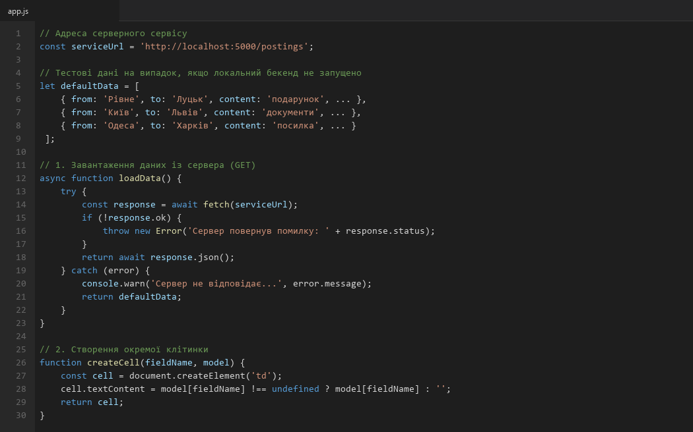
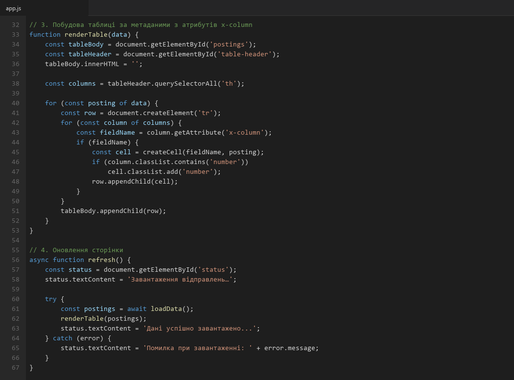
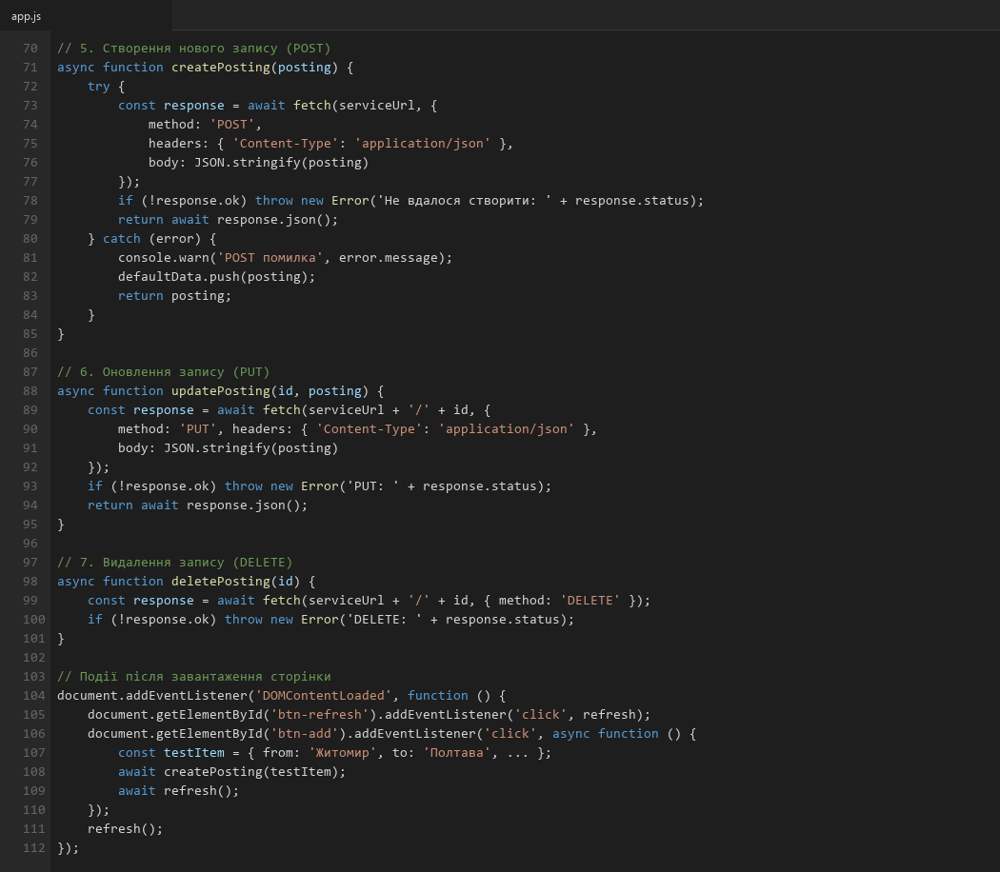
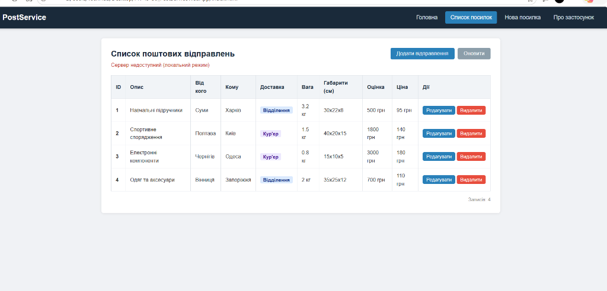
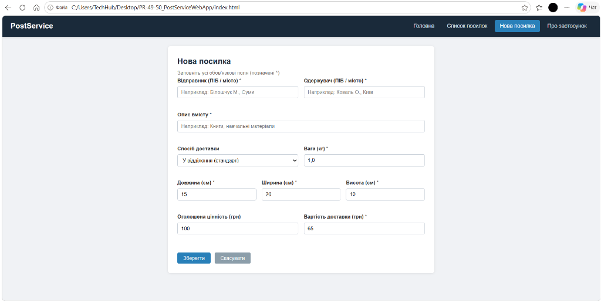

# Практична робота: Ознайомлення з Fetch API

**Дисципліна:** Веб-програмування  
**Студентка:** Овдійчук Марія  

---

## Тема роботи
Ознайомлення з Fetch API для виконання HTTP-запитів до серверного сервісу.

## Мета роботи
Ознайомитися з призначенням Fetch API, навчитися виконувати HTTP-запити GET, POST, PUT і DELETE до серверного сервісу з коду JavaScript, опрацьовувати відповіді асинхронно за допомогою промісів та async/await, відокремлювати завантаження даних від оновлення вмісту сторінки, а також будувати таблицю з отриманих даних, використовуючи метадані з власних атрибутів заголовка таблиці.

---

## Хід роботи

### Крок 1. Підключення до серверного сервісу та завантаження даних (GET)
Реалізовано асинхронну функцію `loadData()`, яка надсилає GET-запит до REST API (`http://localhost:5000/postings`) за допомогою `fetch()`. У разі помилки або відсутності сервера завантажуються локальні тестові дані. Також створено допоміжну функцію `createCell()` для генерації клітинок таблиці.

### Крок 2. Побудова таблиці та оновлення сторінки
Реалізовано функцію `renderTable()`, яка динамічно формує рядки таблиці за метаданими з атрибутів `x-column` заголовків. Функція `refresh()` об'єднує завантаження та відображення даних з індикацією статусу.

### Крок 3. Реалізація CRUD-операцій (POST, PUT, DELETE)
Створено функції `createPosting()` (POST), `updatePosting()` (PUT) та `deletePosting()` (DELETE) для повної взаємодії з серверним API. Підключено обробники подій для кнопок інтерфейсу.

### Крок 4. Перевірка роботи інтерфейсу
Запущено веб-застосунок та перевірено відображення таблиці поштових відправлень із даними, завантаженими через Fetch API:

### Крок 5. Тестування форми створення нового запису
Перевірено роботу сторінки створення нового поштового відправлення з полями для заповнення параметрів посилки:

---

## Контрольні запитання

### 1. Що таке fetch api і для чого він використовується?
Fetch API — це вбудований у браузер інструмент (інтерфейс), за допомогою якого JavaScript може надсилати мережеві HTTP-запити до сервера та отримувати відповіді без перезавантаження сторінки.

### 2. Чим асинхронний виклик відрізняється від синхронного? Чому мережеві запити виконуються асинхронно?
При синхронному виклику браузер зупиняє виконання всього коду і чекає на відповідь, через що інтерфейс зависає. При асинхронному виклику запит надсилається у фоні, а сторінка продовжує працювати і реагувати на дії користувача. Мережеві запити роблять асинхронними саме для того, щоб уникнути зависання інтерфейсу під час очікування відповіді сервера.

### 3. Що таке Promise? У яких станах він може перебувати?
Promise (проміс) — це спеціальний об'єкт у JavaScript, який позначає результат асинхронної операції, що завершиться пізніше.  
Він може бути в трьох станах:
1. Очікування (pending);
2. Виконано успішно (fulfilled / resolved);
3. Завершено з помилкою (rejected).

### 4. Як опрацювати результат проміса за допомогою then() і catch()? Як це зробити за допомогою async/await?
- Через `then()` та `catch()`: викликається `.then(callback)` для обробки успішного результату та `.catch(callback)` для перехоплення помилок.
- Через `async/await`: перед функцією пишеться `async`, всередині перед викликом проміса ставиться `await` (який зупиняє виконання функції до готовності результату), а можливі помилки обробляються звичайним блоком `try { ... } catch (error) { ... }`.

### 5. Як за допомогою fetch() виконати запити GET, POST, PUT і DELETE? Які налаштування потрібні в кожному випадку?
- **GET:** викликається просто `fetch(url)` без другого параметра (тіла немає, метод за замовчуванням).
- **POST:** передається об'єкт налаштувань `{ method: 'POST', headers: { 'Content-Type': 'application/json' }, body: JSON.stringify(data) }`.
- **PUT:** вказується адреса з id (`url + '/' + id`) та налаштування `{ method: 'PUT', headers: ..., body: ... }`.
- **DELETE:** вказується адреса з id та `{ method: 'DELETE' }` (тіло не передається).

### 6. Чому логіку завантаження даних із сервера варто відокремлювати від логіки оновлення вмісту сторінки?
Щоб код був структурованим і легким у підтримці. Якщо логіка завантаження (`loadData`) окремо від відображення (`renderTable`), то зміна вигляду таблиці не зачепить запити до сервера, і навпаки. Також функцію відображення можна протестувати на тестовому масиві даних, а після додавання чи видалення запису достатньо просто викликати спільну функцію `refresh()`.

---

## Висновок
Під час виконання практичної роботи я ознайомилася з використанням Fetch API для взаємодії з сервером. Навчилася відправляти асинхронні запити GET, POST, PUT, DELETE за допомогою `async/await`, обробляти можливі помилки та перевіряти статус через `response.ok`. Також реалізувала динамічне формування таблиці за метаданими з атрибутів `x-column`, що дозволяє змінювати порядок та склад колонок безпосередньо в HTML-розмітці.
