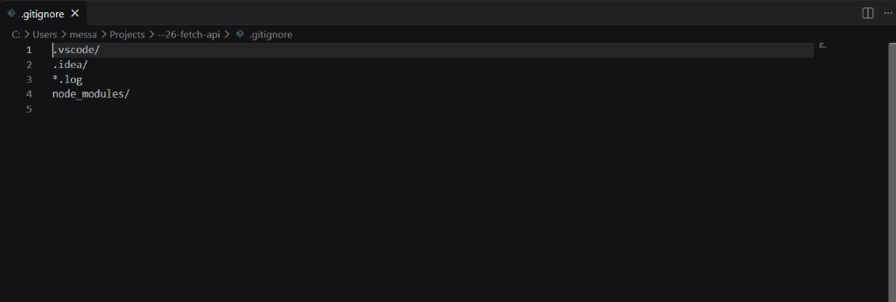
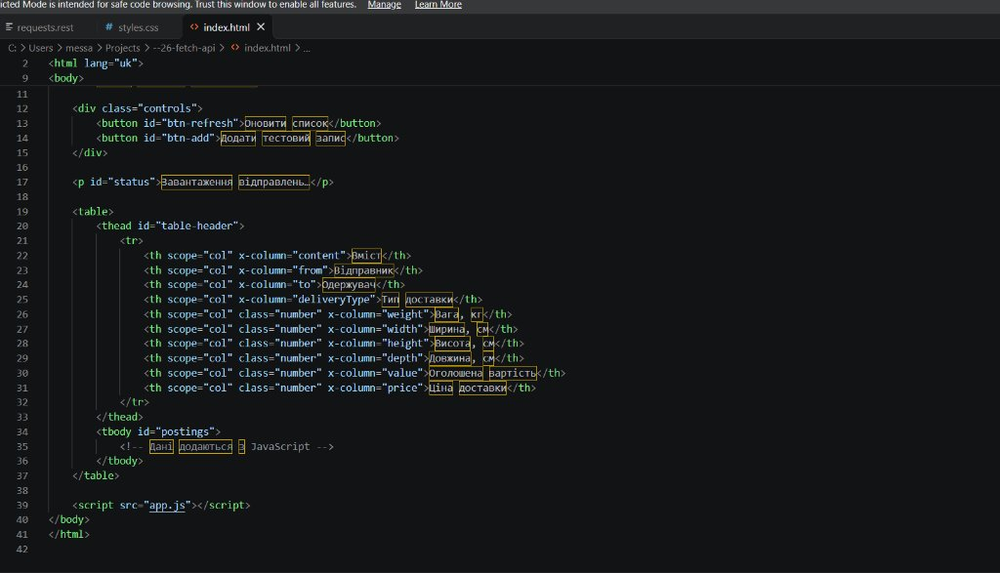
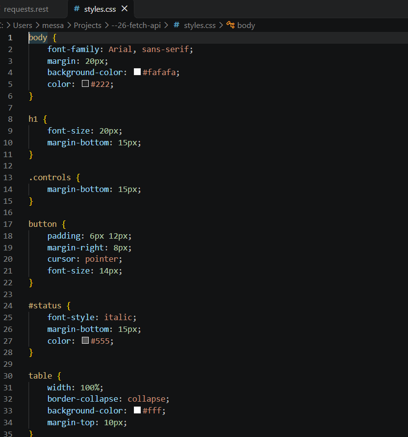
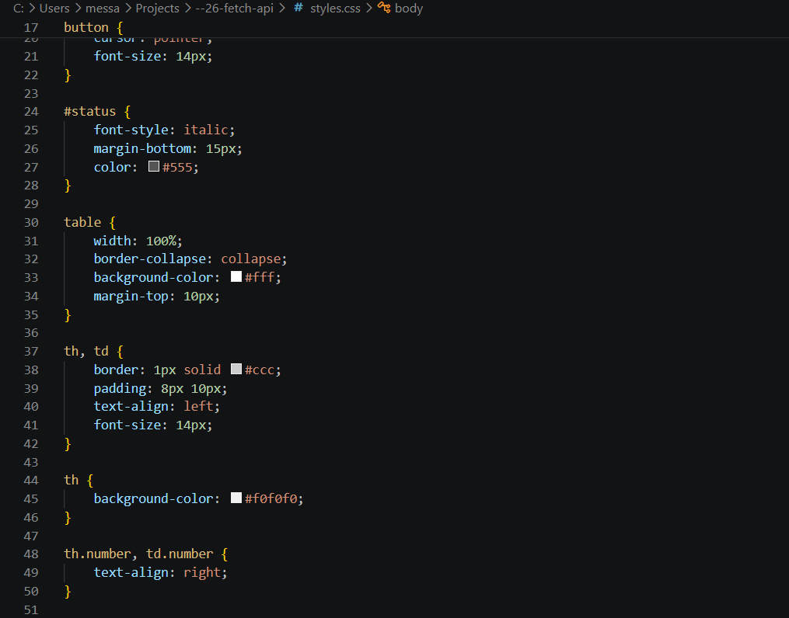
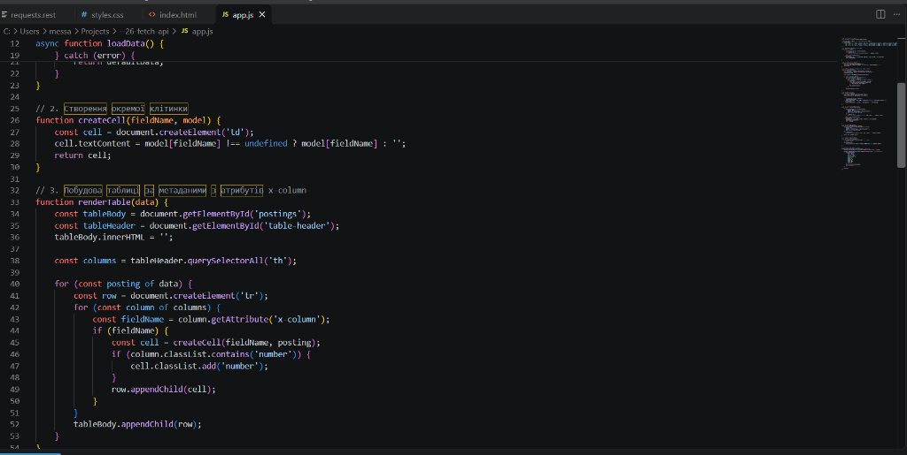
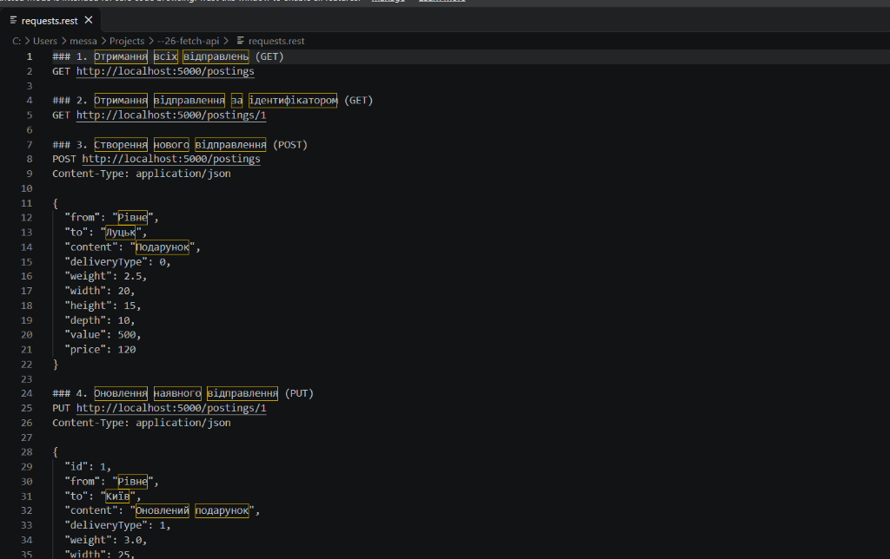
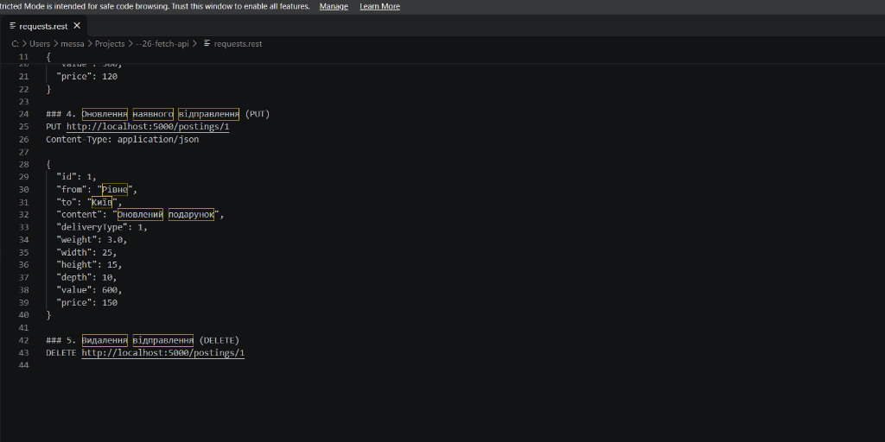
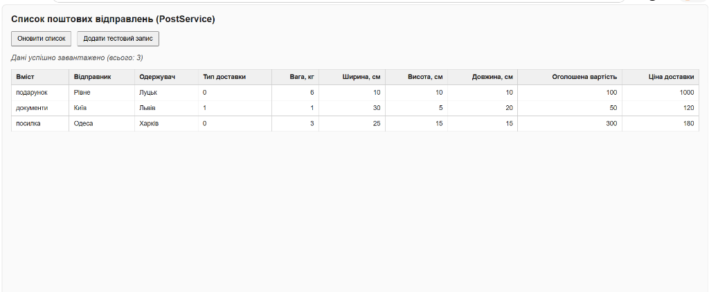
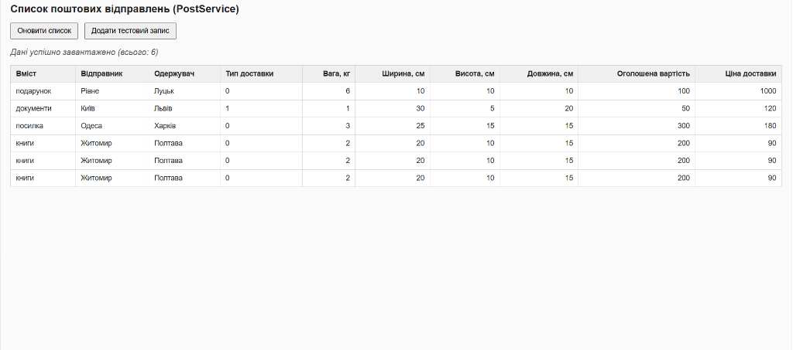

# Практична робота: Ознайомлення з Fetch API

**Тема:** Ознайомлення з Fetch API  
**Мета:** Ознайомитися з призначенням Fetch API, навчитися виконувати HTTP-запити GET, POST, PUT і DELETE до серверного сервісу з коду JavaScript, опрацьовувати відповіді асинхронно за допомогою промісів та async/await, відокремлювати завантаження даних від оновлення вмісту сторінки, а також будувати таблицю з отриманих даних, використовуючи метадані з власних атрибутів заголовка таблиці.

---

## Хід роботи та скріншоти виконання

### 1. Налаштування файлу виключень (.gitignore)
У проєкті створено файл `.gitignore` для виключення системних налаштувань редактора VS Code, логів та залежностей.

---

### 2. Створення розмітки HTML (index.html)
Розроблено структуру сторінки з кнопками керування (`Оновити список`, `Додати тестовий запис`), блоком відображення статусу та таблицею. Заголовки таблиці містять власні метаатрибути `x-column` для динамічного зв'язування з полями моделі даних.

---

### 3. Оформлення стилів (styles.css)
Налаштовано базові стилі для таблиці, кнопок керування, відступів та вирівнювання числових значень за правим краєм (`.number`).

---

### 4. Реалізація логіки роботи з Fetch API (app.js)
Написано асинхронну функцію завантаження даних `loadData()`, функцію динамічного створення клітинок `createCell()` та побудови таблиці за метаданими стовпців `renderTable()`.

---

### 5. Підготовка та тестування HTTP-запитів (requests.rest)
Створено файл запитів до серверної частини PostService для виконання повного набору операцій CRUD: отримання списку (GET), створення запису (POST), редагування (PUT) та видалення (DELETE).

---

### 6. Робота додатку в браузері
Перевірено працездатність інтерфейсу: початкове завантаження поштових відправлень з бекенду та коректне оновлення таблиці після додавання нових тестових записів.

---

## Контрольні запитання

### 1. Що таке fetch api і для чого він використовується?
**Відповідь:**  
Fetch API — це вбудований у браузер інструмент (інтерфейс), за допомогою якого JavaScript може надсилати мережеві HTTP-запити до сервера та отримувати відповіді без перезавантаження сторінки.

---

### 2. Чим асинхронний виклик відрізняється від синхронного? Чому мережеві запити виконуються асинхронно?
**Відповідь:**  
При синхронному виклику браузер зупиняє виконання всього коду і чекає на відповідь, через що інтерфейс зависає. При асинхронному виклику запит надсилається у фоні, а сторінка продовжує працювати і реагувати на дії користувача. Мережеві запити роблять асинхронними саме для того, щоб уникнути зависання інтерфейсу під час очікування відповіді сервера.

---

### 3. Що таке Promise? У яких станах він може перебувати?
**Відповідь:**  
Promise (проміс) — це спеціальний об'єкт у JavaScript, який позначає результат асинхронної операції, що завершиться пізніше.  
Він може бути в трьох станах:
1. Очікування (pending);
2. Виконано успішно (fulfilled / resolved);
3. Завершено з помилкою (rejected).

---

### 4. Як опрацювати результат проміса за допомогою then() і catch()? Як це зробити за допомогою async/await?
**Відповідь:**  
- Через `then()` та `catch()`: викликається `.then(callback)` для обробки успішного результату та `.catch(callback)` для перехоплення помилок.
- Через `async/await`: перед функцією пишеться `async`, всередині перед викликом проміса ставиться `await` (який зупиняє виконання функції до готовності результату), а можливі помилки обробляються звичайним блоком `try { ... } catch (error) { ... }`.

---

### 5. Як за допомогою fetch() виконати запити GET, POST, PUT і DELETE? Які налаштування потрібні в кожному випадку?
**Відповідь:**  
- **GET:** викликається просто `fetch(url)` без другого параметра (тіла немає, метод за замовчуванням).
- **POST:** передається об'єкт налаштувань `{ method: 'POST', headers: { 'Content-Type': 'application/json' }, body: JSON.stringify(data) }`.
- **PUT:** вказується адреса з id (`url + '/' + id`) та налаштування `{ method: 'PUT', headers: { 'Content-Type': 'application/json' }, body: JSON.stringify(data) }`.
- **DELETE:** вказується адреса з id (`url + '/' + id`) та `{ method: 'DELETE' }` (тіло не передається, відповідь 204 не парситься через `.json()`).

---

### 6. Чому логіку завантаження даних із сервера варто відокремлювати від логіки оновлення вмісту сторінки?
**Відповідь:**  
Щоб код був структурованим і легким у підтримці. Якщо логіка завантаження (`loadData`) окремо від відображення (`renderTable`), то зміна вигляду таблиці не зачепить запити до сервера, і навпаки. Також функцію відображення можна протестувати на тестовому масиві даних, а після додавання чи видалення запису достатньо просто викликати спільну функцію `refresh()`.

---

## Висновок
Під час виконання практичної роботи я ознайомилася з використанням Fetch API для взаємодії з сервером. Навчилася відправляти асинхронні запити GET, POST, PUT, DELETE за допомогою `async/await`, обробляти можливі помилки та перевіряти статус через `response.ok`. Також реалізувала динамічне формування таблиці за метаданими з атрибутів `x-column`, що дозволяє змінювати порядок та склад колонок безпосередньо в HTML-розмітці.
